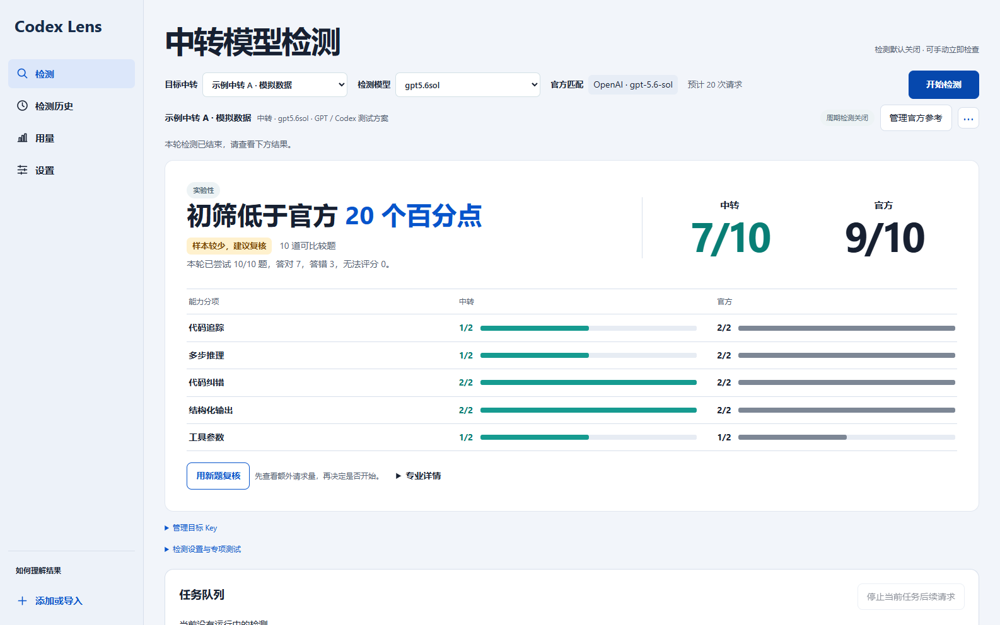

# Codex Lens · 中转模型检测器

用同一组题比较中转模型与匹配的官方模型。桌面端可从 CC Switch 或 Codex++ 导入中转配置，展示答题分项、差距、可比较题数和复核所需的请求量。检测由用户主动启动，周期检测可以单独开启。

Compare a relay and a matching official model on the same tasks. Review the observed gap, available evidence and estimated request count before a follow-up run.

**0.1.0 发布候选 · 实验性检测。** 能力差距用于复核服务表现。真实误报率和检出率仍待按具体型号、协议和设置校准。

- **安装桌面端** · [Windows、macOS、Linux 安装与兼容性](docs/INSTALLATION.md)
- **技术原理** · [检测流程、统计公式、校准和贡献方向](Technical-Documentation-Principles-of-Mathematics-Transfer-Station-Inspection.md)
- **使用文档** · [简体中文](README/README-Simplified_Chinese.md) · [English](README/README.md)
- **源码与贡献** · [CLI 和 Python 接口](docs/EXTENDING.md) · [文件指南](FILE_GUIDE.md) · [构建流程](docs/RELEASING.md) · [MIT](LICENSE)

**与主项目的关系。** Codex Lens 是 Codex Token Usage Monitor 的检测功能模块。独立安装包用于单独运行和验证。后续主项目可通过 v2 匿名快照和 Python 接口接入。 [扩展接入契约](docs/EXTENDING.md#integration-contract--token监视器接入)
